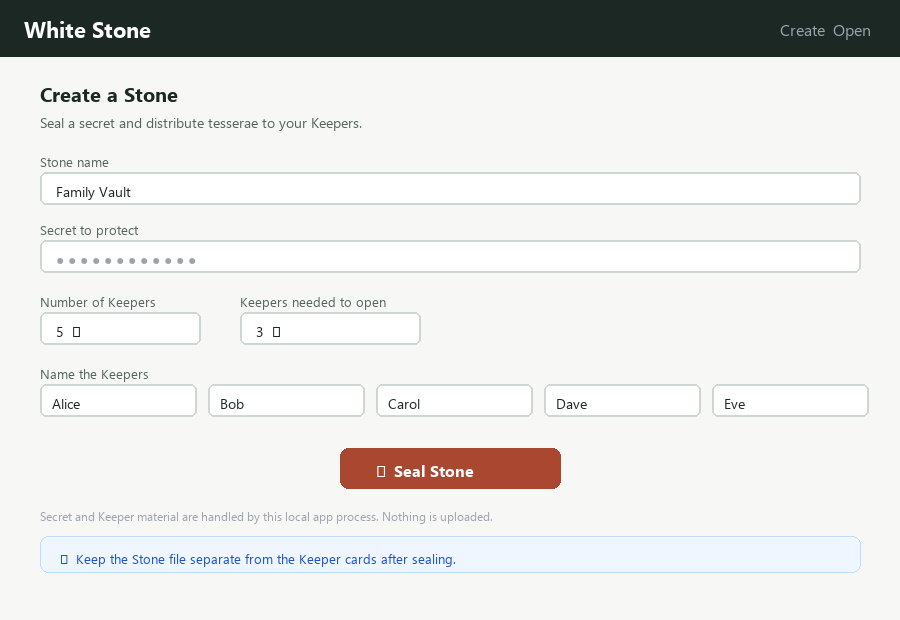
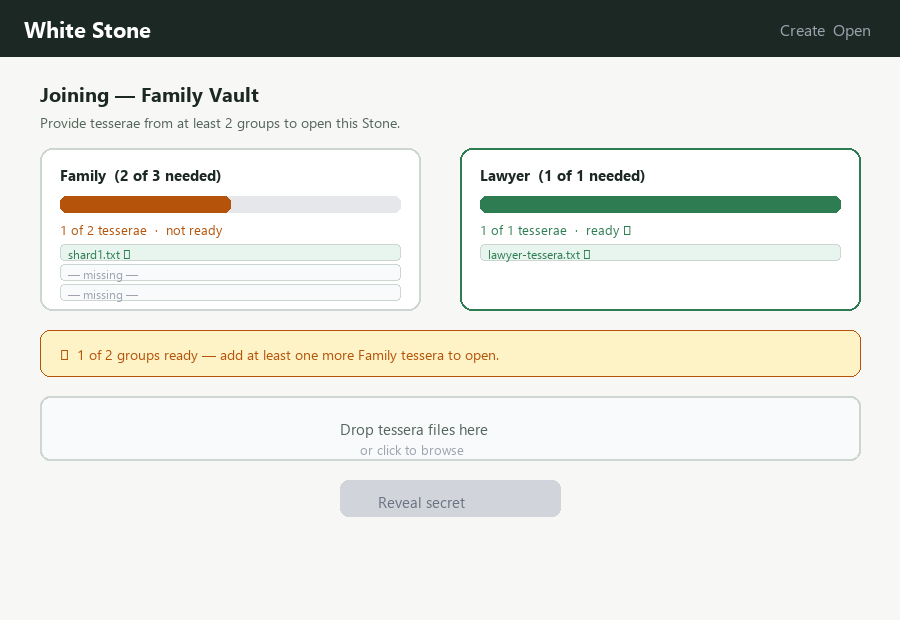

# White Stone v0.2 — How to Use

White Stone encrypts a secret locally, then splits only its random 256-bit key
into SLIP-39 tesserae. A Stone JSON file contains ciphertext and metadata; it
cannot reveal the secret without enough valid tesserae from the required groups.

---

## Contents

1. [Setup](#setup)
2. [Concepts](#concepts)
3. [GUI (recommended)](#gui)
4. [CLI](#cli)
   - [create](#create)
   - [open](#open)
   - [recast](#recast)
5. [Python API](#python-api)
6. [File layout](#file-layout)
7. [Security notes](#security-notes)

---

## Setup

Python 3.10 or newer is required.

```powershell
python -m pip install -e ".[dev]"
```

Or install only runtime dependencies:

```powershell
python -m pip install -r requirements.txt
```

---

## Concepts

| Term | Meaning |
|------|---------|
| **Stone** | The encrypted vault file (`vault.json`). Safe to store anywhere. |
| **Tessera** | A 33-word SLIP-39 phrase. One per Keeper. Keep it private. |
| **Keeper** | A person who holds one tessera. |
| **Group** | A set of Keepers with their own k-of-n threshold. |
| **group_threshold** | How many groups must contribute tesserae to open the Stone. |
| **Rehearsal** | An automatic self-test run at creation time. |
| **Recasting** | Re-encrypting the same secret under a new key with new tesserae. |

---

## GUI

Run the local Streamlit interface:

```powershell
python -m streamlit run streamlit_app.py --server.address 127.0.0.1
```

Open `http://localhost:8501` in your browser.




- **Create tab** — name the Stone, set the threshold, name each Keeper, seal.
- **Open tab** — upload the Stone file and enough tessera files to reveal the secret.

> Bind to `127.0.0.1` as shown. Do not expose to a network or use a hosted
> Streamlit service — it would receive your secret.

---

## CLI

### create

Encrypt a secret and write tesserae + QR PNGs.

**Simple (single group):**

```powershell
white-stone create --k 3 --n 5 --name "Family Vault"
```

Prompts for the secret without echoing. Or pass it directly (less safe):

```powershell
white-stone create --k 3 --n 5 --secret "my secret" --output-dir family-vault
```

Read the secret from a file (avoids shell history):

```powershell
white-stone create --k 3 --n 5 --secret-file secret.txt --output-dir family-vault
```

**Multi-group:**

```powershell
white-stone create --group Family:2:3 --group Lawyer:1:1 --need 2 --name "Estate Vault"
```

This requires 2 of 2 groups: 2-of-3 Family AND 1-of-1 Lawyer.

**Options:**

| Flag | Default | Description |
|------|---------|-------------|
| `--k` | — | Tesserae needed (single-group) |
| `--n` | — | Total tesserae (single-group) |
| `--group Name:k:n` | — | Add a group (repeatable) |
| `--need N` | 1 | Groups needed to open |
| `--name` | Untitled Stone | Display label |
| `--secret` | prompt | Secret text |
| `--secret-file` | — | Read secret from file |
| `--output-dir` | cwd | Where to write files |

Generated files are never overwritten. Use a fresh directory for each Stone.

---

### open

Reveal the secret using enough tesserae.

```powershell
white-stone open --stone vault.json --shard shard1.txt --shard shard3.txt --shard shard5.txt
```

For a multi-group Stone, provide enough shards from enough groups:

```powershell
white-stone open --stone vault.json \
  --shard family-shard1.txt --shard family-shard2.txt \
  --shard lawyer-shard1.txt
```

Passphrase-protected Stones prompt for the passphrase automatically.

---

### recast

Re-key a Stone (Keeper replaced, device lost, threshold changed).

```powershell
white-stone recast --stone vault.json \
  --shard shard1.txt --shard shard2.txt --shard shard3.txt \
  --out new-vault --k 2 --n 3
```

Or recast to a multi-group layout:

```powershell
white-stone recast --stone vault.json \
  --shard shard1.txt --shard shard2.txt --shard shard3.txt \
  --out new-vault --group Family:2:3 --group Lawyer:1:1 --need 2
```

After recasting:
1. Note the printed **retired id**.
2. Delete every copy of the old Stone file.
3. Tell old Keepers to destroy their old tesserae.

---

## Python API

```python
from white_stone import (
    Group, Stone, WhiteStoneError,
    create_stone, create_stone_groups,
    join_progress, join_stone,
    rehearse, recast_stone, parse_tessera,
)

# Simple Stone
stone, tesserae, warnings = create_stone("my secret", k=3, n=5)

# Multi-group Stone
groups = [Group("Family", 2, 3), Group("Lawyer", 1, 1)]
stone, by_group, warnings = create_stone_groups("my secret", group_threshold=2, groups=groups)

# Progress
progress = join_progress(stone, tesserae[:2])
# {"valid": 2, "groups": [...], "groups_done": 0, "groups_needed": 1, "ready": False, "errors": []}

# Open
secret: bytes = join_stone(stone, tesserae[:3])

# Rehearsal (never returns the secret)
result = rehearse(stone, tesserae[:3])
# {"ok": True}

# Recast
new_stone, new_by_group, warnings, retired_id = recast_stone(
    stone, tesserae[:3], k=2, n=3
)

# Block retired Stone
join_stone(stone, tesserae[:3], retired_ids={retired_id})  # raises RETIRED

# Serialise / deserialise
json_text = stone.to_json()
stone = Stone.from_json(json_text)
```

### Error codes

| Code | Meaning |
|------|---------|
| `BAD_INPUT` | Invalid parameters |
| `BAD_FORMAT` | Unreadable file or tessera |
| `BAD_CHECKSUM` | Tessera is damaged or mistyped |
| `WRONG_STONE` | Tessera belongs to a different Stone |
| `DUPLICATE` | Same tessera added twice |
| `NOT_ENOUGH` | Not enough valid tesserae |
| `NEEDS_PASSPHRASE` | Protected Stone requires passphrase |
| `DECRYPT_FAILED` | Wrong passphrase or tampered file |
| `UNSUPPORTED_VERSION` | Stone file version mismatch |
| `RETIRED` | Stone has been retired via recast |

---

## File layout

```
vault.json          Stone file — safe to store, useless without tesserae
shard1.txt          Tessera phrase for Keeper 1
shard1.png          QR code for Keeper 1
shard2.txt / .png   …and so on
```

For multi-group Stones, shards are numbered sequentially across groups
(group 1 first, then group 2, etc.).

---

## Security notes

- Uses PyNaCl's XChaCha20-Poly1305 and the `shamir-mnemonic` SLIP-39 library.
  No cryptographic primitives are implemented here.
- The Stone file format changed in v0.2 (`v: 2`). Version 1 files are refused.
- `--secret` may appear in shell history; prefer the hidden prompt or `--secret-file`.
- Tessera files and QR PNGs are sensitive — distribute each through a separate channel.
- Python cannot reliably erase secrets from memory.
- The GUI runs locally. Bind to `127.0.0.1`; never expose it to a network.
- **No real secrets until an independent security review is complete.**
